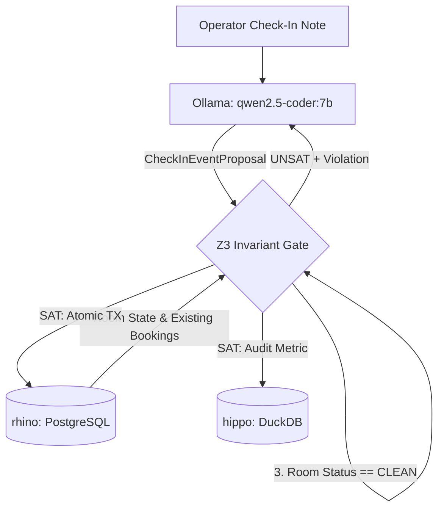

# hostel-ops — Neuro-Symbolic Triple-Entry Ledger & Booking Engine

Transactional backend for check-in operations, housekeeping state transitions, and triple-entry event accounting. Unstructured operator notes are compiled into strict financial-operational proposals and committed to PostgreSQL (`rhino`) only after formal invariant verification in Z3 (`hippo`).

> Part of the [`sandbox-init`](https://github.com/spanskikh/sandbox-init) neuro-symbolic cluster. See [`docs/ARCHITECTURE.md`](https://github.com/spanskikh/sandbox-init/blob/main/docs/ARCHITECTURE.md) for system design and ADRs.

## Transactional & Verification Flow


## Formal Invariants (Z3)
* **Conservation Law (Triple-Entry Balance):** Sum of all ledger legs in an event equals zero (`sum(amount_cents) == 0`) with strictly positive turnover.
* **Anti-Overbooking Guarantee:** Half-open stay intervals `[check_in, check_out)` for any `bed_id` are pairwise disjoint (`co <= b_ci OR ci >= b_co`).
* **Housekeeping State Machine:** Check-in is permitted exclusively into `CLEAN` beds; committing atomically transitions state to `DIRTY`.

## Sample CEGIS Execution
```text
CEGIS Converged: True in 1 iter(s)
  Committed to rhino PostgreSQL! Bed state transitioned: CLEAN -> DIRTY
```

## MCP Tools (`FastMCP` / `stdio`)
* `audit_hostel_checkin` — Formal Z3 verification of check-in intervals, room state, and triple-entry balance.
* `ingest_operator_checkin_note` — Parses natural-language check-in notes, verifies invariants in Z3, and commits atomically to PostgreSQL.

## Quickstart & QA Gate
```bash
docker compose build ledger
docker compose run --rm ledger sh -c "ruff check src tests && mypy src tests && pytest -v"
docker compose run --rm ledger python -m hostel_ops.cegis
```
