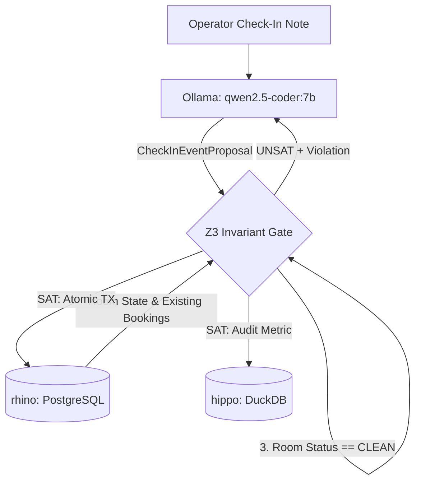

# hostel-ops — Neuro-Symbolic Triple-Entry Ledger & Booking Engine

Транзакционный бэкенд учёта заездов, управления состоянием номеров и тройной событийной бухгалтерии. Неструктурированные заметки дежурного администратора компилируются в строгие финансово-операционные события и допускаются в PostgreSQL (`rhino`) только после доказательства инвариантов в Z3 (`hippo`).

## Транзакционный и верификационный контур



## Формальные инварианты (Z3)
* **Закон сохранения (Triple-Entry Balance):** сумма всех проводок в событии строго равна нулю (`sum(amount_cents) == 0`) при положительном обороте.
* **Отсутствие овербукинга:** полуинтервалы проживания `[ci, co)` для одной койки попарно не пересекаются (`co <= b_ci OR ci >= b_co`).
* **Housekeeping State Machine:** заезд разрешён исключительно в статус `CLEAN`; при фиксации транзакции койка атомарно переводится в `DIRTY`.

## MCP-инструменты (`FastMCP` / `stdio`)
* `audit_hostel_checkin` — формальная проверка события заезда и бухгалтерских проводок через Z3 и состояние БД.
* `ingest_operator_checkin_note` — парсинг заметки администратора, верификация инвариантов в Z3 и атомарная запись в PostgreSQL.

## Запуск и QA-гейт
```bash
docker compose build ledger
docker compose run --rm ledger sh -c "ruff check src tests && mypy src tests && pytest -v"
docker compose run --rm ledger python -m hostel_ops.cegis
```
