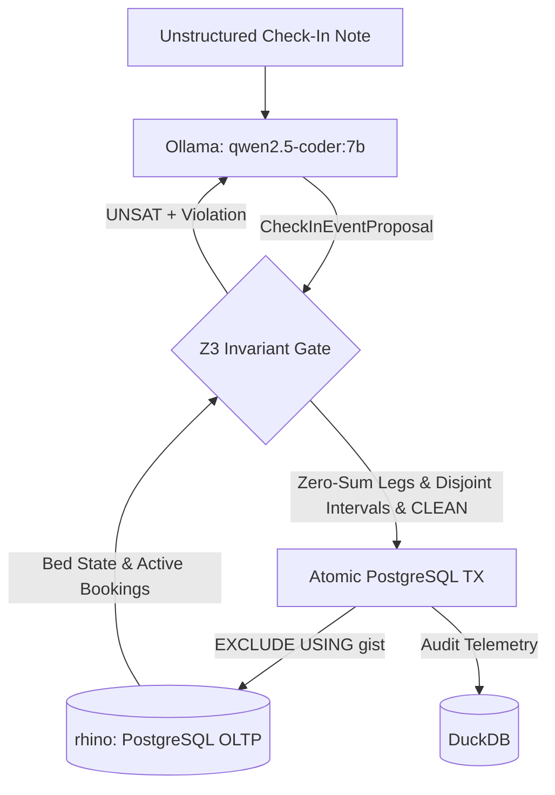

# Architecture & Formal Verification Design — `hostel-ops`

Domain-level architecture for neuro-synbolic check-in operations, housekeeping state machines, and triple-entry ledger accounting across `hippo` (Z3 + DuckDB) and `rhino` (PostgreSQL + `btree_gist`). Part of the [`sandbox-init`](https://github.com/spanskikh/sandbox-init) cluster.

## 1. Transactional & Dual-Layer Invariant Topology

## 2. Architecture Decision Records (ADR)
- **ADR-HOS-001 (Defense-in-Depth Anti-Overbooking — CR-004 & CR-007):** Z3 proves interval disjointness (`co <= b_ci OR ci >= b_co`) prior to commit, while PostgreSQL enforces `EXCLUDE USING gist (bed_id WITH =, int4range(check_in_day, check_out_day, '[*') WITH &&)` in the storage engine to eliminate TOCTOU race conditions.
- **ADR-HOS-002 (Idempotent DDL Katalog Migration — BUG-001 / CAPA-001):** `init_schemas()` verifies `pg_constraint` explicitly via `DO $$ ... ALTER TABLE ... $$` instead of relying on `CREATE TABLE IF NOT EXISTS`.
- **ADR-HOS-003 (Triple-Entry Conservation):** Every financial event requires balanced legs (`sum(amount_cents) == 0`) with strictly positive volume.

## 3. Trade-offs & Risk Control Matrix
- **Concurrent Booking TOCTOU:** Database-level `btree_gist` exclusion constraint verified under barrier-synchronized `asyncio` concurrency (`CR-007`); second transaction fails with SQLSTATE `23P01` (`ExclusionViolation`).
- **Stateful Schema Drift (BUG-001):** Idempotent `pg_constraint` migration guard + live `@pytest.mark.integration` test against `rhino` (`CAPA-002`).
